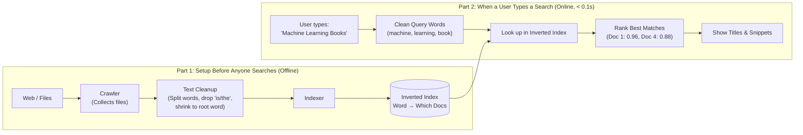

# Module 1: How Search Works — From Messy Files to Smart Meaning

> **The Big Picture Story (Where We Start):**  
> Imagine you just joined a college or company and someone hands you a hard drive with **50,000 messy files** — PDFs, attendance spreadsheets, lecture slides, photos, and voice notes. Over the next 6 modules, we are going to build a **smart AI search and answer system** from scratch. Every topic in this module exists because we hit a real problem along the way and needed a clever fix!

---

## Syllabus Checklist (Every Topic Covered)
- **1.1** What IR is, Data vs. Information vs. Knowledge, How people search, Trends & Research issues, IR System Architecture & Retrieval Process
- **1.2** Query Structures (Keyword, Pattern Matching, Structured) & Structured vs. Unstructured Knowledge
- **1.3** Neural IR & Modern AI Retrieval (Dense retrieval, Embeddings, Multimodal embeddings, Sparse vs. Dense & when Sparse wins, Late interaction / ColBERT — *plus fixing a mistake in Slide 39!*)
- **1.4** Advanced Attention Mechanisms for Retrieval AI (GQA, Sliding Window Attention / Longformer, FlashAttention — *missing from class slides, explained from online sources*)

---

## Chapter 1 (Syllabus 1.1): Before You Can Search, What Are You Looking At?

### Step 1: Turning Raw Numbers Into Decisions (Data → Information → Knowledge)
Open the first file on that messy hard drive. You see a plain list:
`101: 92`, `102: 68`, `103: 85`, `104: 74`, `105: 58`.

Right now, those numbers are useless because you don't know what `101` or `92` even means. That brings us to our first three building blocks:

1. **Data (Raw ingredients):** Plain facts or numbers with **no context or meaning**. (`101`, `92`)
2. **Information (Cooked meal):** Data that is **organized and labeled** so it actually answers a question.
   - *Attendance Report:* `Student 101 | Rahul | 92%`, `Student 105 | Karan | 38%`. Now you know Karan has 38% attendance!
3. **Knowledge (Actionable wisdom):** Information combined with **rules and experience** so you can **make a decision**.
   - Rule: *"Below 75% needs a warning; below 50% cannot sit for the exam."*
   - Decision: `Rahul (92%) → Eligible`, `Priya (74%) → Warning`, `Karan (38%) → Not eligible for End-Sem`.

Now suppose a professor asks: *"Find me all notices about exam attendance rules from these 50,000 files."*  
That job — **finding the right stuff for a user's question out of a giant pile of messy files** — is called **Information Retrieval (IR)**.

> **SQL Database vs. Information Retrieval (Simple Difference):**  
> In a neat database, you ask an exact rule like `"Give me student_id = 101"` and get one exact row. In **Information Retrieval**, files are messy (text, PDFs, web pages), so there is no single "exact match"—the computer has to **guess how useful each file is** and show the best ones at the top.

---

### Step 2: How Real Humans Actually Search
Before we build our search box, watch how a real person uses it:

1. **Old Textbook View (Static / Classic Search):** Assumes you sit down knowing *exactly* what you want in 4 neat steps: `Notice a problem → Put it into words → Type a query → Read the answer and leave.`
2. **Real-Life View (Dynamic / "Berry-Picking" Model):** Think about picking berries in a forest. You don't stand under one bush and grab everything at once. You pick a berry from one bush, see another bush nearby, learn what ripe berries look like, and change direction! In search, **people learn as they read the first few results** and keep updating their search words along the way.
3. **Exploratory Search (When one search isn't enough):**
   - **Learning search:** Scanning and reading several articles to understand a new topic (e.g., studying for tomorrow's viva!).
   - **Investigating:** Long-term digging across days or weeks—double-checking facts carefully to make sure you didn't miss anything important (like medical or legal research).

---

### Step 3: Building Our First Search Engine (The IR System Architecture)
Okay, let's build a search engine for 4 sample documents on our hard drive:
- **Doc 1:** `"Machine Learning using Python"`
- **Doc 2:** `"Python Programming Basics"`
- **Doc 3:** `"Deep Learning"`
- **Doc 4:** `"Machine Learning Algorithms"`

**The First Problem We Hit:** If a user types `"Machine Learning"` and our program opens all 50,000 files one by one to check if those words appear, the user will wait 10 minutes!

**The Clever Fix — Build a Back-of-the-Book Index (Offline + Online):**
Think about the index at the back of a textbook. You don't read the whole book to find `"Python"`; you flip to `"P"`, see `Python → pages 1, 2`, and jump straight there! Search engines do the exact same thing in two stages:

Let's walk through what happens step-by-step:
1. **Collect Files (Crawler):** A bot gathers files from folders or the web into a **Document Collection**.
2. **Clean Up the Text (Text Transformations):**
   - **Tokenization:** Chop sentences into individual words (`"Machine"`, `"Learning"`).
   - **Stop-word removal:** Throw away filler words like `"using"`, `"the"`, `"is"`, `"in"` that appear everywhere and waste space.
   - **Stemming vs. Lemmatization (Shrinking words to their root):** If a doc says `"retrieving"` and you search `"retrieval"`, they wouldn't match!
     - *Stemming* roughly chops word endings (`retrieving → retriev`, `books → book`) — super fast, sometimes leaves funny half-words.
     - *Lemmatization* uses a real dictionary (`better → good`, `retrieving → retrieve`) — cleaner, slightly slower.
3. **Build the Inverted Index:** Flip `Doc → Words` upside down into **`Word → Docs`**:
   - `machine` → `[Doc1, Doc4]`
   - `learning` → `[Doc1, Doc3, Doc4]`
   - `python` → `[Doc1, Doc2]`
4. **Search & Rank:** User searches `"Machine Learning Books"`. The engine checks the lists for `machine` (`Doc1, Doc4`) and `learning` (`Doc1, Doc3, Doc4`), sees `Doc1` and `Doc4` match both words, scores them (`Doc1: 0.96`, `Doc4: 0.88`), and puts the best ones at the top.

---

### Step 4: Why Are Researchers Still Improving Search Today? (Trends & Issues)
Wait—if Google already searches the web in 0.4 seconds, why is this still a huge research field? Because search evolved from **matching words** (1990s) → **ranking web links with PageRank** (1998) → **understanding meaning** (2010–2020) → **answering questions directly with AI & Knowledge Graphs** (2024+). Six big problems are still hard:
1. **Too Much Data (Information Explosion):** Billions of new pages, videos, and files appear daily — how do we store and index them cheaply?
2. **Better Ranking (Relevance):** Knowing *what the user truly meant*, not just which page repeated a keyword.
3. **AI-Powered Search (From Links to Answers):** Moving from `Type keywords → click 10 blue links` to `Ask a question → AI reads trusted docs → gives one clear, honest answer`.
4. **Searching Beyond Text (Multimodal Search):** Taking a photo of a shoe (Google Lens) or humming a tune and finding matching text, videos, or products.
5. **Privacy & Trust:** Letting employees search private company files without leaking confidential payroll data or letting the AI make up fake facts.
6. **Real-Time / Live Search:** News, stock prices, and traffic change every second — indexes must update live as data streams in.

---

## Chapter 2 (Syllabus 1.2): Different Shapes of Data & Different Ways to Ask

As our hard drive grows, we realize not all files look the same. There are **three flavors of data**, and each needs a different way of searching:

### 1. Structured vs. Semi-Structured vs. Unstructured Knowledge

| Flavor | What It Looks Like (Everyday Picture) | Real Examples | How We Store & Search It | Pros & Cons |
| :--- | :--- | :--- | :--- | :--- |
| **Structured** | A strict Excel sheet or neat library register—every row has the exact same columns. *(Rule checked before saving = **Schema-on-Write**)* | Bank ledgers, student grades table, Knowledge Graphs | **Relational DB** (PostgreSQL, Oracle) or **Knowledge Graph** (Neo4j, RDF); searched with **SQL / Cypher / SPARQL** | **Pro:** 100% exact math (`SUM`, `AVG`), ultra-fast. **Con:** Hard to change columns later; misses human nuance; SQL needs slow `JOIN`s for deep links. |
| **Semi-Structured** | A digital form where people can add extra sticky notes—has tags/labels, not rigid columns. *(Checked when reading = **Schema-on-Read**)* | JSON files, XML, product catalogs where phones have `screen_size` and books have `author` | **Document DBs** (MongoDB, Elasticsearch) | **Pro:** Flexible fields and nested lists. **Con:** Harder to enforce strict cross-table rules. |
| **Unstructured** | A messy box of essays, emails, photos, and audio clips (~80%+ of all company data!). *(No fixed schema)* | PDFs, clinical doctor notes, contracts, voice calls, images | **Data Lakes** (AWS S3), **Inverted Indexes**, **Vector DBs** (Qdrant, Milvus) | **Pro:** Captures full human richness & nuance. **Con:** Computers can't do exact math or filters on it without AI extraction first! |

**Quick Side-Note on Storing Structured Data (Tables vs. Graphs):**
- **Tables (RDBMS)** store rows and columns and link them with IDs (Foreign Keys). Asking *"Who are the friends of my colleague's boss?"* forces the database to stitch tables together over and over (**expensive `JOIN`s**).
- **Knowledge Graphs** draw people as **circles (Nodes)** and links as **arrows (Edges)**. Answering that same question just means walking along 3 arrows!

---

### 2. Three Ways Users Ask Questions (Hierarchy of Query Structures)

Think of query languages like ordering food—from pointing casually to writing a formal contract:

#### Level 1: Keyword Queries (Everyday Search Box)
You just type raw words (`"machine learning"`). The engine treats your query like a **bag of words** (ignoring grammar) and checks the Inverted Index.
- **Handy shortcuts you can use:**
  - `cloud AND database` → Both words must appear.
  - `"machine learning"` → Exact phrase next to each other in that order.
  - `python -snake` → Must have `python`, must **NOT** have `snake`.
  - `title:retrieval` → Look only inside the title field.
- **Where plain keywords break:**
  1. Misses synonyms (`"cheap hotel"` won't find `"inexpensive lodging"`).
  2. Confuses double-meaning words (`"river bank"` vs. `"bank account"`).
  3. Breaks on typos (`"algoritm"` gets 0 hits).
  4. Can't do math rules (`"shoes under $50"`).

#### Level 2: Pattern Matching Queries (Searching by Word Shape)
Instead of exact dictionary words, you search for **patterns of characters**:
1. **Wildcards:** Use `*` (any letters) or `?` (one letter). Example: `comput*` catches `computer`, `computing`, `computation`. In SQL: `WHERE email LIKE '%@gmail.com'`.
2. **Glob Expressions:** Used in computer folders/terminals to match file paths, like `/var/log/app_2024_??.log`.
3. **Regular Expressions (Regex):** A strict pattern recipe for checking formats like phone numbers or license plates: `[A-Z]{3}-\d{4}` matches `ABC-1234`.
4. **Fuzzy Matching (Edit Distance):** Fixes human typos! **Levenshtein Edit Distance** counts the smallest number of single-letter tweaks (**Insert, Delete, or Replace**) needed to turn one word into another.
   - *Easy Example:* Turning `"cat"` into `"cut"` = **1 edit** (replace `a → u`). Turning `"kitten"` into `"sitting"` = **3 edits** (`k→s`, `e→i`, add `g`). So `fuzzy("algorithm")` with distance $\le 1$ still catches `"algoritm"`!

#### Level 3: Structured Queries (Formal Database Languages)
Exact rules on structured tables or graphs—zero guesswork:
- **SQL (for Tables):** `SELECT department, COUNT(*) FROM employees WHERE salary > 80000 GROUP BY department;`
- **SPARQL (for RDF Triple Graphs):** Find scientists born in Paris who won a Nobel Prize.
- **Cypher (for Property Graphs):** `MATCH (p:Person)-[:WORKS_AT]->(c:Company) WHERE c.name = 'Google' RETURN p`
- **GraphQL (for Web APIs):** Ask an API for *only* the user's `name` and `recentPosts` instead of downloading a massive blob.

> **Modern Trick:** Today's best search engines combine all three! First filter with **Structured Metadata** (`price < 200`), then run **Keywords + Smart AI Meaning Search**, and merge the results.

---

## Chapter 3 (Syllabus 1.3): Teaching Search to Understand Meaning (Neural IR)

### The Big Problem With Everything So Far
Suppose a user searches for `"Car"`.  
Your best document says: `"An automobile is a four-wheeled vehicle."`

Old-school **Sparse Retrieval** (exact keyword matching, like **BM25** in Elasticsearch/Lucene) looks for the letters `C-A-R`. It doesn't find them, so **it misses the best document completely!**

*(Why is it called "Sparse"? Because if your dictionary has 50,000 English words, a document vector has 50,000 slots—and 49,990 of them are `0`!)*

---

### The Clever Fix: Meaning Maps (Dense Retrieval & Embeddings)
What if instead of counting exact words, an AI reads text and turns it into a **short list of numbers** (say, 384 or 768 numbers, like `[0.12, -0.35, 0.78, ...]`) called an **Embedding**?

Think of an embedding like **GPS coordinates on a giant "Meaning Map"**:
- Texts with **similar meanings** get placed right next to each other on the map, even if they share **zero** words!
- So `"Car"` and `"Automobile"` land right next to each other. `"I love AI"` and `"I enjoy Artificial Intelligence"` land right next to each other!
- Now searching just means: *"Put the user's question on the map, and grab the nearest documents!"* This is **Dense Retrieval** (or **Embedding-Based Search**).

---

### Putting Pictures & Sounds on the SAME Meaning Map (Multimodal Embeddings)
What if you want to search **photos** or **audio clips** using regular text?
That's what **Multimodal Embeddings** do! We train a **Text reader** (like BERT), a **Picture reader** (like a Vision Transformer / CNN), and a **Sound reader** (like Whisper / audio CNN) to drop their answers onto the **same shared map**.
- **How do they learn to agree on the map?** Using millions of `(photo, caption)` pairs (like OpenAI's **CLIP**): the AI pulls the GPS point of a dog photo close to the GPS point of `"a dog playing in the park"`, and pushes wrong captions far away.
- **Real examples:** Searching your Google Photos for `"beach sunset"`, Google Lens, Spotify matching music mood, or finding similar X-ray scans from a doctor's text note.

---

### Wait — Does Dense Search Always Beat Keyword Search (BM25)?
**NO! This is a favorite viva trap question.**

Think about when GPS "meaning maps" actually hurt you:
Suppose a programmer searches `"error code E4021"`, or a lawyer searches `"Section 420 IPC"`, or a chemist searches `"BRCA1-204"`.
- A **Dense (Meaning) model** sees `"E4021"` and thinks *"Oh, that looks like an error code, let me return articles about `E4022` or `E5001`!"* — **useless!**
- **Sparse Retrieval (BM25)** searches for the **exact characters `E4021`** and nails it every single time!

**When Sparse (BM25) Beats Dense Retrieval:**
1. **Legal documents** (exact section numbers, contract clauses).
2. **Scientific papers & patents** (exact chemical formulas, gene names, rare technical jargon the AI rarely saw in training).
3. **Exact-match lookups** (error codes, product model numbers, part SKUs, people's exact names).

| Feature | Sparse Retrieval (BM25) | Dense Retrieval (Embeddings) |
| :--- | :--- | :--- |
| **How it matches** | Exact keywords | Meaning / intent |
| **Vector shape** | Huge (50,000+ slots), mostly `0`s | Compact (384–1536 slots), all non-zero numbers |
| **Great at** | Exact codes, names, legal/scientific terms, speed | Synonyms (`car`/`automobile`), paraphrases, natural questions |
| **Weak at** | Synonyms, wording differences | Rare codes/IDs, brand-new jargon |

---

### What If Squashing a Whole Page Into ONE Dot Loses Too Much? (ColBERT / Late Interaction)
Imagine reading a 2-page article that talks about *exercise helping mood, heart health, sleep, and stress*. If a normal Dense Retriever (**Bi-Encoder**) compresses the **entire 2-page article into one single GPS dot**, all those specific details get blended together into one blurry average!

You *could* feed the Question + Document together word-by-word into BERT (**Cross-Encoder**) so every query word looks at every document word—super accurate, **but way too slow** if you have 10 million documents because you can't pre-save anything!

**ColBERT (Contextualized Late Interaction over BERT)** finds the genius middle ground:
1. **Don't squash the document into 1 dot!** Keep **one small vector for EVERY word (token)** in the document, and save all of them ahead of time.
2. When the user searches, turn each word of the query into its own vector.
3. For each query word, find the **single best-matching word in the document (`MaxSim`)**, and add up those best scores!
   $$\text{Score}(Q, D) = \sum_{\text{each query word } i} \max_{\text{each doc word } j} (q_i \cdot d_j)$$

**Why ColBERT wins:** It keeps word-level precision (and even lets you highlight *which exact words matched*!) while still letting you pre-compute document vectors offline!

> [!WARNING]
> **Watch Out for a Mistake on Class Slide 39 (`Module 1 .pptx.pdf`)!**  
> Slide 39 labels standard single-vector Dense Retrieval (Bi-Encoder) as **"EARLY INTERACTION"**. That is factually backwards!
> - **Bi-Encoder (Single-Vector Dense):** Encodes Query and Doc separately into 1 vector each → **NO word-level interaction** until the final cosine score.
> - **Cross-Encoder:** Reads `[CLS] Query [SEP] Doc [SEP]` together from Layer 1 → that is **Early Interaction** (slowest, highest accuracy).
> - **ColBERT:** Encodes separately, compares tokens at the very end (`MaxSim`) → **Late Interaction**.

---

## Chapter 4 (Syllabus 1.4): Reading Huge Documents Without Melting the GPU *(Not in PPTs — Online Sources)*

Now our smart AI retriever works great on short paragraphs. **Next roadblock:** What happens when we ask our Transformer AI to read a **30-page legal contract (32,000 words)** at once?

In a standard Transformer, **Self-Attention** works like a classroom where **every student shakes hands with every other student**.
- For 10 words → $10 \times 10 = 100$ handshakes (easy!).
- For 32,000 words → $32{,}000 \times 32{,}000 \approx \mathbf{1\text{ billion}}$ handshakes **per layer**! Your GPU immediately runs out of memory and slows to a crawl. Also, when an LLM writes an answer after reading long retrieved docs, storing memory notes (**KV Cache**) for every word eats massive GPU RAM.

Three clever upgrades fix these exact bottlenecks:

### 1. Grouped-Query Attention (GQA) — *Sharing Memory Notes While Writing*
When an AI reads and generates text, it uses multiple "readers" (**Query heads**), and each reader normally keeps its own giant notebook of **Keys ($K$) and Values ($V$)** in GPU memory (**KV Cache**).
- **Old Way — Multi-Head Attention (MHA):** 8 readers, 8 separate notebooks. Very smart, **huge memory bottleneck** when reading long retrieved RAG passages!
- **Extreme Shortcut — Multi-Query Attention (MQA):** All 8 readers share **1 single notebook**. Super fast and tiny memory, **but quality drops**.
- **Smart Compromise — Grouped-Query Attention (GQA):** Split the 8 readers into **groups** (say, 4 groups of 2). Each group shares **1 notebook** (`8 Q heads`, `2 or 4 KV heads`).
- **Result:** Cuts KV Cache memory by **2×–8×** for fast long-context answers while keeping accuracy almost identical to full MHA! *(Used in Llama 3, Mistral, Gemma.)*

### 2. Sliding Window Attention (Longformer) — *Stop Shaking Hands With People Across the Stadium*
In a 32,000-word book, does word #5 really need to directly attend to word #29,412 in every single layer? Usually a word mostly depends on its **neighbors**!
- **How Longformer works:**
  1. **Local Sliding Window:** Each word only looks at a fixed spotlight of $W$ nearby words (say 256 words left and 256 words right).
  2. *Wait—how does information travel across the whole document then?* Just like passing a whisper down a row! In Layer 1 a word learns from neighbors 256 away; in Layer 2 those neighbors pass info from 512 away; after 12 layers, info travels thousands of words!
  3. **Global Spotlight Tokens:** A few VIP tokens (like `[CLS]` or the user's **query words**) still connect to **every** word in the document so important global questions don't get lost.
- **Result:** Handshakes drop from **$N^2$** down to **$N \times W$** (scales smoothly in a straight line as documents get longer!).

### 3. FlashAttention — *A Hardware Speed Hack With Zero Approximation!*
*(Important for viva: GQA and Sliding Window change the attention math slightly. **FlashAttention computes the EXACT SAME math** as normal attention — it's just way smarter about how GPUs move data!)*

- **The Hidden Bottleneck:** Inside a GPU, there is a **huge slow warehouse** (**HBM**, like 40 GB VRAM) and a **tiny super-fast workbench** (**SRAM**, ~20 MB right next to the math chips). Normal attention builds the massive $N \times N$ score table, carries it back and forth between the slow warehouse and fast workbench multiple times, and wastes most of its time **waiting on memory delivery**!
- **FlashAttention's Two Tricks:**
  1. **Tiling:** Chop $Q, K, V$ into tiny bite-sized tiles that fit right on the super-fast **SRAM workbench**, do all the attention math there, and never even save that huge $N \times N$ table to the slow warehouse!
  2. **Online Softmax:** Softmax normally needs to see an entire row of numbers at once. FlashAttention uses a running running-total math trick to update softmax block-by-block on the fly with **zero loss of accuracy**!
- **Result:** **2×–4× faster** and uses **linear $O(N)$ memory** instead of $O(N^2)$—making long-context retrieval and LLMs practical!

| Mechanism | Everyday Analogy | Problem Solved | Exact Math? |
| :--- | :--- | :--- | :--- |
| **GQA** | 8 readers sharing 2–4 notebooks instead of 8 | Shrinking huge KV Cache during LLM generation | Architectural middle-ground (MHA ↔ MQA) |
| **Sliding Window (Longformer)** | Only shaking hands with nearby neighbors + a few VIP messengers | Eliminating $O(N^2)$ compute/memory on huge docs | Approximate (local + sparse global) |
| **FlashAttention** | Doing all math in small tiles on a tiny fast workbench instead of walking to the slow warehouse | Eliminating slow GPU memory traffic (HBM I/O) | **100% Exact** |

---

## Where We Go Next → Module 2
Awesome—now our search engine can read files, build an Inverted Index, search by exact words or meaning maps, and even handle huge documents! **Next problem:** When 500 documents match our query, **how do we score them accurately, index 100 million vectors without taking minutes, mix BM25 + Dense together, and run this at real companies?** That's **Module 2**!

---

## Quick Viva Questions & Plain-English Answers
1. **Q: Data vs. Information vs. Knowledge?**  
   *A:* Data is raw numbers (`92`), Information adds labels/meaning (`Rahul scored 92%`), and Knowledge applies rules to decide (`Rahul is eligible for the exam`).
2. **Q: What is an Inverted Index?**  
   *A:* A lookup table mapping each word to the list of documents containing it (`Word → Docs`), just like the index at the back of a textbook.
3. **Q: What is the Berry-Picking model?**  
   *A:* Unlike old static search models, real users learn from the results they read and keep changing their query step by step.
4. **Q: When does Sparse search (BM25) beat Dense embedding search?**  
   *A:* Whenever exact characters/codes matter most—like legal sections, error codes (`E4021`), chemical formulas, patents, or rare technical terms.
5. **Q: Why is ColBERT called "Late Interaction" (and what did Slide 39 get wrong)?**  
   *A:* ColBERT keeps one vector per token and compares query tokens vs. doc tokens via `MaxSim` at the very end (**late interaction**). Slide 39 mistakenly calls single-vector Bi-Encoders "early interaction"—actually **Cross-Encoders** are early interaction, and Bi-Encoders have no token-level interaction until the final single cosine score.
6. **Q: Compare GQA, Longformer Sliding Window, and FlashAttention.**  
   *A:* **GQA** groups query heads to share KV heads, cutting inference KV cache memory. **Longformer** uses a local sliding window + few global tokens to cut attention from $O(N^2)$ to $O(N \cdot W)$. **FlashAttention** uses GPU SRAM tiling + online softmax to compute **exact** attention 2×–4× faster with $O(N)$ HBM memory.
