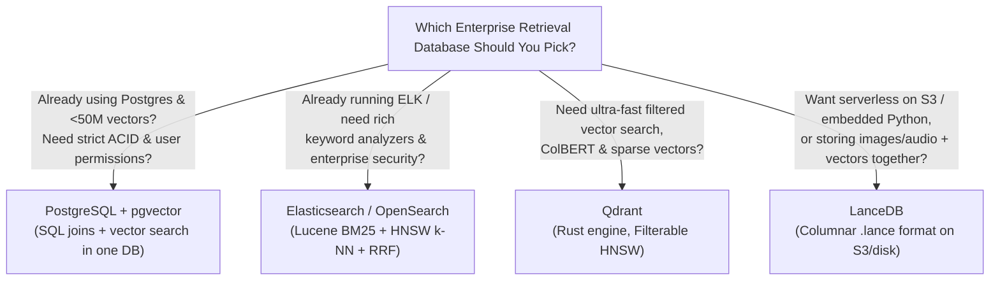

# Module 2: Scoring Results, Speeding Up Billions of Vectors & Running at Companies

> **Continuing Our Story (From Module 1 → Module 2):**  
> In Module 1, we built a basic search engine that finds documents using keywords or meaning maps. **Now we hit our next big problems:**  
> 1. If 500 documents match `"machine learning"`, **how do we give each one a fair score** to decide #1, #2, and #3?  
> 2. When our collection grows to **100 million vectors**, checking every vector one-by-one takes way too long and eats terabytes of RAM—**how do we organize them for millisecond speed?**  
> 3. How do we combine keyword search + meaning search, add permission filters, teach an LLM to answer politely, and pick real company databases (**Elasticsearch, OpenSearch, pgvector, Qdrant, LanceDB**) to run it all?

---

## Syllabus Checklist (Every Topic Covered)
- **2.1** Review of IR models (Vector Space Model, Probabilistic Model / BIM), Transition from BM25 to dense representations, Neural ranking architectures & semantic similarity search *(+ all 4 unsolved practice problems solved + Vector PDF math bug fixed!)*
- **2.2** Vector indexing (Embedding generation, Vector storage, ANN: HNSW, IVF, Product Quantization), Hybrid Search (BM25 + Dense), Metadata-aware filtering, LLM Fine-Tuning & Alignment (LoRA, SFT, RLHF, DPO)
- **2.3** Enterprise Retrieval Infrastructure (Elasticsearch, OpenSearch, PostgreSQL `pgvector`, Qdrant, LanceDB — *barely mentioned/missing in PPTs, explained simply from online sources*)

---

## Chapter 1 (Syllabus 2.1): How Do Search Engines Decide #1 vs. #2?

Imagine you search `"gold silver truck"` across 3 documents. Every document mentions at least one of those words. How do we score and rank them? Researchers tried **three classical ways** before inventing neural AI rankers:

### Try 1: The Arrow Game — Vector Space Model (VSM) & TF-IDF
Imagine every unique word in our collection is a direction on a compass (e.g., North = `gold`, East = `silver`, Up = `truck`).
- Each document becomes an **arrow** pointing toward the words inside it.
- Your query becomes an **arrow** too.
- A document is a great match if its arrow **points in almost the same direction** as your query arrow — meaning the **angle $\theta$** between them is tiny!

**How long should each word's arrow step be? Use TF-IDF!**
If a document says `"the"` 20 times, that shouldn't beat a document saying `"gold"` 2 times! So we weigh each word by **TF × IDF**:
- **TF (Term Frequency):** How often the word appears in *this* document (shows what this document talks about).
- **IDF (Inverse Document Frequency):** How *rare* the word is across *all* $N$ documents ($\text{df}(t)$ = how many docs contain $t$):
  $$\text{IDF}(t) = \log\left(\frac{N}{\text{df}(t)}\right)$$
  - Common word in every doc ($\text{df} = N$) → $\log(1) = 0$ (ignored!).
  - Rare word → high IDF (huge boost!).
- **Cosine Similarity** measures how closely two arrows point in the same direction (ignoring document length!):
  $$\cos(\theta) = \frac{\mathbf{d} \cdot \mathbf{q}}{\|\mathbf{d}\| \|\mathbf{q}\|}$$
  (`1.0` = exact same direction, `0.0` = no shared words at all.)

#### Careful! Fixing a Bug in the Professor's Worked Example (`Module 2_ Problems on Vector Model.pdf`)
Query: `"gold silver truck"`  
- **D1:** `"Shipment of gold damaged in a fire"`  
- **D2:** `"Delivery of silver arrived in a silver truck"`  
- **D3:** `"Shipment of gold arrived in a truck"`

> [!CAUTION]
> **Two Bugs in the Professor's Vector Model PDF (Pages 1–3):**
> 1. **Switched log bases:** Table 2 calculates IDF using **$\log_2$** (`0.585` for `gold/truck`, `1.585` for `silver`), then the Cosine Similarity math quietly plugs in **$\log_{10}$ rounded values** (`0.18`, `0.48`, `0.96`). *(In exact math, changing log base cancels out in Cosine Similarity, only intermediate rounded numbers change.)*
> 2. **Dropped a term in D2:** On Page 2, the dot product for D2 writes `(0.96·0.48) + (0.18·0.18) = 0.4608`. Actually $0.96 \times 0.48 = 0.4608$ **plus** $0.18 \times 0.18 = 0.0324$ equals **$0.4932$**! Because of that missing `+ 0.0324`, the PDF wrote `0.770` instead of **`0.824`**. (Note: stopwords `of, in, a` are also silently dropped after Table 1.)

With consistent $\log_2$ (`gold=0.585, silver=1.585, truck=0.585`; $\|Q\| = 1.7879$):
- **Rank 1 — D2:** $\frac{3.17(1.585) + 0.585(0.585)}{3.6394 \times 1.7879} = \mathbf{0.825}$
- **Rank 2 — D3:** $\frac{0.585^2 + 0.585^2}{1.1700 \times 1.7879} = \mathbf{0.327}$
- **Rank 3 — D1:** $\frac{0.585^2}{2.3893 \times 1.7879} = \mathbf{0.080}$

#### Solutions to the 2 Unsolved Practice Questions (`Vector Model PDF`)
*(Removing stopwords and using consistent $\log_2$; words absent from all docs get weight $0$, and words in all $N=3$ docs get $\text{IDF}=\log_2(3/3)=0$.)*

1. **Practice Q1 — Query `"natural disaster relief"`:**
   - **D1:** `"Emergency relief provided after the earthquake"` | **D2:** `"Flood relief efforts are underway"` | **D3:** `"Relief supplies for disaster victims arrived today"`
   - `relief` appears in all 3 docs ($\text{df}=3 \implies \text{IDF}=0$). `natural` appears in 0 docs ($\text{IDF}=0$). `disaster` (and every unique word) has $\text{df}=1 \implies \text{IDF}=\log_2(3/1)=1.585$.
   - Only `disaster` has non-zero weight in the query ($\|Q\|=1.585$). **D1** and **D2** don't have `disaster`, so $\cos(D1, Q)=\mathbf{0}$, $\cos(D2, Q)=\mathbf{0}$. **D3** has 5 non-zero words ($\|D3\| = 1.585\sqrt{5}$), dot $= 1.585^2$, so $\cos(D3, Q) = \frac{1}{\sqrt{5}} = \mathbf{0.447}$.
   - **Ranking:** **D3 (0.447) > D1 (0) = D2 (0)**. *(Tip: with smoothed IDF, `relief` wouldn't be zero and would separate ties.)*

2. **Practice Q2 — Query `"machine learning algorithms"`:**
   - **D1:** `"Introduction to machine learning algorithms and their applications"` | **D2:** `"Deep learning and its relationship with machine learning"` | **D3:** `"Comparing various machine learning techniques for data analysis"`
   - `machine` and `learning` appear in all 3 docs ($\text{IDF}=0$). `algorithms` appears only in **D1** ($\text{IDF}=1.585$).
   - **D1** has 3 unique non-zero terms (`introduction, algorithms, applications` → $\|D1\| = 1.585\sqrt{3}$), so $\cos(D1, Q) = \frac{1}{\sqrt{3}} = \mathbf{0.577}$. **D2** and **D3** lack `algorithms`, so both score $\mathbf{0}$.
   - **Ranking:** **D1 (0.577) > D2 (0) = D3 (0)**.

---

### Try 2: The Detective Game — Probabilistic Model (Binary Independence Model / BIM)
Instead of measuring angles between arrows, a detective asks: **"Based on past examples of Good (Relevant) and Bad (Non-relevant) documents, what are the odds this document is relevant?"**

BIM makes two simple assumptions: (1) just check if each query word is **present (1) or absent (0)**, and (2) treat each word independently. For query word $i$ (out of $N$ total docs, $|R|$ relevant docs, $r_i$ relevant docs containing word $i$, $n_i$ total docs containing word $i$):
- Chance word $i$ appears in a **relevant** doc (adding `+0.5` so we never divide by zero):
  $$p_i = \frac{r_i + 0.5}{|R| + 1}$$
- Chance word $i$ appears in a **non-relevant** doc:
  $$q_i = \frac{(n_i - r_i) + 0.5}{(N - |R|) + 1}$$
- **Word Importance Score ($c_i$)** and **Total Document Score ($\text{RSV}$):**
  $$c_i = \log_2\left[\frac{p_i(1-q_i)}{q_i(1-p_i)}\right], \qquad \text{RSV}(D) = \sum_{i \in Q \cap D} c_i$$

#### Solutions to the 2 Unsolved Practice Questions (`Probabilistic Model PDF`)
1. **Practice Q1 — Query `"exam study tips"`** ($N=5$, Relevant $R = \{D1, D2\}$ so $|R|+1=3$, Non-Relevant $NR = \{D3, D4, D5\}$ so $(N-|R|)+1=4$):
   - **D1 (R):** `"study tips for final exam"` | **D2 (R):** `"best exam preparation and study techniques"`
   - **D3 (NR):** `"cooking tips for beginners"` | **D4 (NR):** `"exam schedule announced today"` | **D5 (NR):** `"study abroad programs"`
   - `exam` ($r=2, n=3$): $p=2.5/3=0.833$, $q=1.5/4=0.375$ → ratio $= 8.333$ → $c = \mathbf{+3.059}$
   - `study` ($r=2, n=3$): $p=0.833$, $q=0.375$ → $c = \mathbf{+3.059}$
   - `tips` ($r=1, n=2$): $p=1.5/3=0.500$, $q=1.5/4=0.375$ → ratio $= \frac{0.3125}{0.1875} = 1.667$ → $c = \mathbf{+0.737}$
   - **Final Ranking:** **D1 (`6.855`) > D2 (`6.118`) > D4 (`3.059`) = D5 (`3.059`) > D3 (`0.737`)**.

2. **Practice Q2 — Query `"laptop battery life"`** ($N=5$, $R=\{D1, D2\}$, $NR=\{D3, D4, D5\}$):
   - **D1 (R):** `"laptop battery life comparison 2025"` | **D2 (R):** `"how to improve laptop battery life"`
   - **D3 (NR):** `"laptop screen repair guide"` | **D4 (NR):** `"battery charger for phones"` | **D5 (NR):** `"daily life productivity tips"`
   - Every query word (`laptop`, `battery`, `life`) appears in both R docs ($r=2$) and 1 NR doc ($n=3$), so all three get $p=0.833$, $q=0.375$, $c = \mathbf{+3.059}$!
   - **Final Ranking:** **D1 (`9.177`) = D2 (`9.177`) > D3 (`3.059`) = D4 (`3.059`) = D5 (`3.059`)**.

---

### Try 3: The Real-World Keyword Champion — BM25
Why did plain TF-IDF fall short? Two reasons:
1. **Keyword Spamming:** If someone repeats `"Hadoop"` 50 times in a document, plain TF-IDF rewards them way too much. Real life has **diminishing returns** (the 2nd mention matters a lot; the 50th mention barely adds anything!).
2. **Long vs. Short Documents:** `"Hadoop"` appearing twice in a 20-word note is a huge clue; appearing twice in a 2,000-word book is tiny.

**BM25 (Best Matching 25)** builds on the Probabilistic Model and fixes both issues in one formula:
$$\text{Score}(D, Q) = \sum_{i} \text{IDF}(q_i) \cdot \frac{f(q_i, D) \cdot (k_1 + 1)}{f(q_i, D) + k_1 \cdot \left(1 - b + b \cdot \frac{|D|}{\text{avgdl}}\right)}$$

- **$k_1$ (usually `1.2–2.0`):** Controls **saturation** (how fast repeated words stop giving extra points).
- **$b$ (usually `0.75`):** Controls **length fairness** (`b=1` adjusts fully for doc length $|D|/\text{avgdl}$; `b=0` ignores doc length).
- *Quick Class Example:* `"neural"` appears $4$ times, $\text{IDF}=2.0$, $k_1=1.5$, $b=0.75$, $|D|=120$, $\text{avgdl}=100$:
  Length factor $= 1 - 0.75 + 0.75(1.2) = 1.15 \implies \text{Score} = 2.0 \times \frac{4(2.5)}{4 + 1.5(1.15)} = 2.0 \times \frac{10}{5.725} \approx \mathbf{3.49}$ (instead of $4 \times 2.0 = 8.0$!).

---

### Moving Beyond Exact Words: Neural Ranking & Semantic Search
Even BM25 only matches **exact words** — it still has the **Semantic Gap** (`"mobile phones"` misses `"cellular devices"`, and `"Java"` the island matches `"Java"` the language).

Here is how AI fixed that in 4 steps:
1. **Word2Vec (2013):** Learned word meaning from neighbors (*"You shall know a word by the company it keeps"*) via **Skip-gram** (word → predict neighbors) and **CBOW** (neighbors → predict word), yielding magic meaning math: $\text{king} - \text{man} + \text{woman} \approx \text{queen}$.
2. **Transformers & BERT (2017–2018):** Word2Vec gave one static vector per word (`"bank"` couldn't change by context) and RNNs forgot early words in long texts. **Self-Attention** lets every word look at all other words in parallel. **BERT** pre-trained on billions of words by guessing masked blanks from both left and right context, then fine-tuned for search (**SBERT** for sentences, **DPR** for question-passage pairs, **ColBERT** per-token late interaction).
3. **How We Train Neural Rankers (Learning to Rank — 3 Styles):**
   - **Pointwise:** Score one `(query, doc)` at a time (simple, ignores ranking order).
   - **Pairwise:** Learn that `good_doc > bad_doc` (e.g., RankNet; Bi-encoders use **Contrastive / Triplet loss** to pull matches closer and push mismatches apart).
   - **Listwise:** Optimize the whole ranked list at once to maximize metrics like NDCG.
4. **The Two-Stage Funnel (Best of Both Worlds):**
   - A **Bi-Encoder** encodes query and doc **separately** → fast (~10 ms via pre-built index), good accuracy.
   - A **Cross-Encoder** reads `[CLS] Query [SEP] Doc [SEP]` **together** → highest accuracy, **but way too slow** for millions of docs.
   - **Solution:** `Stage 1 (Fast BM25/Dense fetches top ~1,000 in <100ms) → Stage 2 (Slow Cross-Encoder carefully re-ranks those 1,000 down to top 10)`.

**How we measure closeness between two dense embeddings:**
- **Cosine Similarity:** Measures angle only (`[-1, 1]`) — ignores length, safest default.
- **Euclidean ($L_2$) Distance:** Straight-line ruler distance between points (smaller = closer).
- **Dot Product ($A \cdot B$):** Fastest (no division!). Equal to cosine similarity if vectors are normalized to length 1.

---

## Chapter 2 (Syllabus 2.2): Scaling to 100 Million Vectors, Hybrid Search & Teaching the LLM

### 1. The Size Problem: Why Checking Every Vector Breaks Down
Suppose our company splits documents into **200–500 token chunks** (with ~20% overlap so we don't chop a sentence right down the middle) and turns each into a 1536-number vector.
- **Math shock:** `1 million docs × 1536 numbers × 4 bytes = 6.1 GB`! `1 billion × 768 dims = 3 TB`!
- Scanning 100 million vectors one-by-one (**Brute Force**, $O(N)$) takes seconds per user!

### 2. Three Clever Shortcuts: Approximate Nearest Neighbor (ANN) Algorithms
Instead of checking *every* vector, organize them beforehand so search checks only a tiny promising neighborhood (**100×–1000× faster**, sacrificing ~1–2% accuracy):

| Shortcut | Everyday Analogy | How It Works | Key Knobs & Trade-off |
| :--- | :--- | :--- | :--- |
| **IVF** *(Inverted File Index)* | **Library subject shelves:** Walk straight to the "Science" aisle instead of scanning every book in the building! | Group vectors into `nlist` clusters (`k-means`). At search time, only scan the `nprobe` closest cluster buckets. | `nprobe` ↑ = higher accuracy, slower search. Balanced speed & memory. |
| **HNSW** *(Hierarchical Navigable Small World)* | **Highway → Main Road → Street:** Take expressways on the top map to cross the country fast, then drop to local streets to find the exact house! | Multi-layer graph. Top layers have sparse long-range links; bottom Layer 0 has every vector with short-range links. Searches top-down in $O(\log N)$. | `M` (links/node), `efConstruction`, `efSearch` (speed/recall knob). **Fastest & highest accuracy**, but graph edges eat lots of **RAM**! |
| **PQ** *(Product Quantization)* | **Zip codes instead of full addresses:** Shrink a 3,072-byte vector down to **8 bytes** (384× smaller!) | Chop a 768-dim vector into $m=8$ pieces (96 dims each). Replace each piece with a 1-byte ID of its nearest cluster centroid (256 choices). Compare distances using lookup tables! | Cuts RAM drastically so billions fit in memory. Loses a bit of precision; **paired with IVF (`IVFPQ`)** in production (FAISS)! |

*(Also **LSH — Locality Sensitive Hashing:** hashes similar vectors into the same bucket.)*

---

### 3. Hybrid Search: Combining Exact Keywords + Meaning Maps
Neither BM25 nor Dense Search is perfect alone:
- `"error code E4021"` → BM25 wins; Dense gets confused.
- `"how do I cancel my subscription?"` matching `"ending your membership"` → Dense wins; BM25 gets 0!

**Solution:** Run **BM25 AND Dense Search in parallel**, then fuse the lists!
1. **Reciprocal Rank Fusion (RRF — The Easy, No-Tuning Default):**
   BM25 scores (`0` to `45`) and Cosine scores (`-1` to `1`) use completely different scales—you can't just add them! RRF ignores raw scores and uses **only rank positions**:
   $$\text{RRF\_score}(d) = \sum_{\text{each list}} \frac{1}{k + \text{rank}(d)} \qquad (\text{usually } k = 60)$$
   *Example:* Doc A is #1 in BM25 and #3 in Dense → $\frac{1}{61} + \frac{1}{63} = 0.0323$. Doc B is #4 in BM25 and #1 in Dense → $\frac{1}{64} + \frac{1}{61} = 0.0320$. Doc A wins because it scored well in *both*!
2. **Weighted Score Combination:** Normalize both scores to `[0, 1]`, then take $\alpha \cdot \text{BM25} + (1-\alpha) \cdot \text{Dense}$ (gives more control if you have test data to tune $\alpha$).

---

### 4. Metadata Filtering: Respecting Dates, Categories & Permissions
Real search needs rules like: *"Only show billing docs from 2024 that this employee has permission to read."*
- **Pre-Filtering (Filter first → Search remaining vectors):** 100% obeys rules, *but* if only 1% of docs pass the filter, HNSW graph paths break and speed drops toward slow brute force.
- **Post-Filtering (Search top-$k$ first → Throw out rule-breakers):** Keeps ANN super fast, *but* you might throw away 9 of your 10 results and show almost nothing!
- **Real-World Fix:** Store fast **Payload/Inverted Indexes** on metadata fields, **partition/shard** by customer/tenant, and let an **Adaptive Planner** choose pre-filtering (narrow filters) or post-filtering with over-fetching (broad filters).

---

### 5. Teaching the LLM to Be Helpful & Safe (Fine-Tuning & Alignment)
Now we can hand great retrieved passages to a pretrained LLM—**but** a raw base LLM only knows how to continue text, not act like a helpful assistant!

- **Full Fine-Tuning vs. LoRA (PEFT):** Updating 100% of an LLM's weights takes giant expensive GPUs. **LoRA** freezes the huge base matrix $W$ (e.g., 16.8M weights) and trains two tiny helper matrices $A \times B$ (~65K weights = **0.4%**!), saving massive GPU memory and letting you swap adapters on one shared model!
- **SFT (Supervised Fine-Tuning):** Show the model `(Question, Ideal Answer)` examples so it learns to follow instructions. *Limitation:* Imitation doesn't teach *"Answer A is safer/better than Answer B."*
- **RLHF (Reinforcement Learning from Human Feedback):** Humans rank outputs → train a **Reward Model** → use **PPO** (reinforcement learning) to push the LLM toward higher rewards. Great results, **but complex & unstable**!
- **DPO (Direct Preference Optimization):** The simpler modern upgrade! **Skips the Reward Model and PPO completely**, directly teaching the model from `(prompt, good_answer, bad_answer)` pairs using a stable, simple training loss!

---

## Chapter 3 (Syllabus 2.3): Where Do Real Companies Run All This? *(Not in PPTs — Online Sources)*

When a company deploys enterprise RAG, which database software do they actually install? Here are the 5 systems in your syllabus:

| Tool | Plain-English Identity | How It Stores & Indexes Vectors | Killer Superpower | Watch Out For |
| :--- | :--- | :--- | :--- | :--- |
| **Elasticsearch** | The heavyweight Java search giant built on **Apache Lucene**. | Segments on disk + HNSW `dense_vector` + Lucene inverted index. | Best-in-class native **BM25 + k-NN + RRF**, deep text analyzers, enterprise RBAC. | Heavy JVM RAM usage & ops work; non-Apache license (SSPL/ELv2/AGPL). |
| **OpenSearch** | The **100% open-source (Apache 2.0)** twin forked from Elasticsearch (backed by AWS). | Lucene, **FAISS**, or NMSLIB engines (HNSW & IVF-PQ). | Free Apache 2.0 enterprise hybrid search, drop-in AWS integration. | Same heavy JVM cluster footprint. |
| **PostgreSQL + `pgvector`** | A lightweight plugin turning your existing **PostgreSQL** SQL DB into a vector DB! | Adds `vector` column (`<=>` cosine, `<->` L2) with **IVFFlat** & **HNSW** indexes. | **Zero new server to manage!** True ACID transactions, SQL `JOIN`s & row-level permissions. | Slower past ~10M–50M vectors without careful RAM tuning; lacks native ColBERT. |
| **Qdrant** | A sleek, dedicated vector database written in **Rust** for raw speed. | In-memory / mmap **HNSW** + scalar/product/**binary quantization** (32× smaller RAM). | **Filterable HNSW** (metadata filtering doesn't break graph search!), native sparse & ColBERT vectors. | One more separate database to sync with your main SQL app. |
| **LanceDB** | A modern **serverless / embedded** multimodal vector DB built on the `.lance` columnar format. | Stores data natively on cheap **S3 / object storage** or local disk (IVF-PQ / HNSW) with zero-copy reads. | **Zero server bill when idle!** Stores raw **images, audio, text & vectors together** in one table. | Newer ecosystem for huge multi-tenant cluster ops. |

---

## Where We Go Next → Module 3
Our RAG search engine can now find paragraphs fast and feed them to an aligned LLM. **But wait:** what if a user asks *"Which respiratory drugs cause tremors, and which two diseases share cough and breathlessness?"* Vector search just hands back 10 messy paragraphs and hopes the LLM connects the dots! What if we store **exact connected facts directly** like a brain's web of knowledge? That brings us to **Module 3: Knowledge Graphs!**
