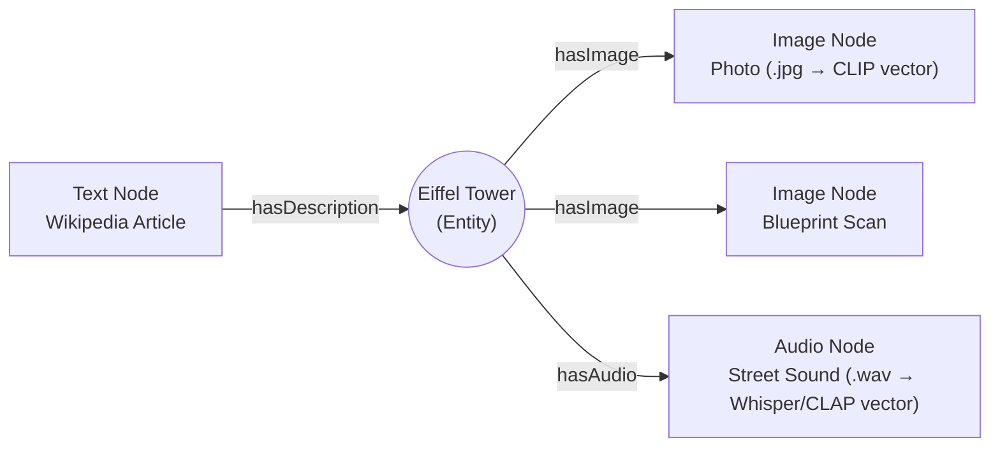

# Module 3: From Messy Paragraphs to Connected Facts (Knowledge Graphs)

> **Continuing Our Story (From Module 2 → Module 3):**  
> In Module 2, we built a super-fast search engine that retrieves matching paragraphs. **Here is the new problem we hit:** Suppose a doctor asks, *"Which diseases cause both Cough and Breathlessness, and which drugs treat them?"* A vector search hands you 10 long medical PDFs and forces the LLM to hunt for clues—and sometimes the LLM guesses wrong!  
> Think about how **Google's Knowledge Panel** works: when you search a celebrity or company, Google doesn't just give blue links—it instantly shows a neat fact box with their birthday, spouse, awards, and photos. How? By storing **exact connected facts** as a **Knowledge Graph**!

---

## Syllabus Checklist (Every Topic Covered)
- **3.1** Knowledge Graph fundamentals: Triples `(subject–predicate–object)`, Nodes, Edges, Properties; Multimodal KGs (text, image, audio nodes)
- **3.2** Graph Models & Cross-Model Design: Labeled Property Graph (LPG), Cross-domain & Cross-modal modeling, Schema design, Ontology basics & Avoiding modeling anti-patterns *(expanded with textbook anti-patterns)*; Intro to RDF, OWL & SPARQL *(expanded with OWA vs. CWA & Clinical KG+RAG case)*
- **3.3** Model Evaluation & Explainability: Perplexity, BLEU, ROUGE, METEOR, BERTScore, LLM-as-Judge *(reconciling Slide 35/36 Perplexity & adding Explainability link)*

---

## Chapter 1 (Syllabus 3.1): Breaking Facts Into Tiny Building Blocks

### Step 1: What Is a Knowledge Graph? (And Why Do We Need It?)
Instead of locking facts inside long sentences (`"Dolly Balwani won a photography contest in 2024"`) or rigid SQL tables, a **Knowledge Graph (KG)** stores knowledge the way your brain remembers it: **things connected to other things**.

- **vs. Plain Text:** Machines can't easily compute over raw sentences. A KG turns messy text into clean, exact, machine-readable facts once—so you can query them instantly forever.
- **vs. SQL Tables:** SQL forces everything into fixed columns; adding a new kind of relationship means redesigning tables and running slow `JOIN`s. Graphs are flexible—you just draw a new arrow!

### Step 2: The Triple — The Smallest Atom of Knowledge
Every fact in a Knowledge Graph shrinks down to a simple 3-word sentence called a **Triple**:
$$(\text{Subject} \xrightarrow{\text{Predicate}} \text{Object})$$

- **Subject:** Who or what it's about (`Marie Curie`).
- **Predicate (Edge):** The directional relationship (`discovered`).
- **Object:** What it connects to (`Radium`).

**Why triples turn into a web (a Graph):** Look what happens when we write 5 simple triples:
1. `(Marie Curie, bornIn, Warsaw)`
2. `(Marie Curie, discovered, Radium)`
3. `(Marie Curie, marriedTo, Pierre Curie)`
4. `(Pierre Curie, discovered, Radium)`
5. `(Radium, isA, ChemicalElement)`

Because `Marie Curie` and `Radium` are **reused** instead of repeated as separate copies, those 5 sentences snap together like Lego bricks into one connected graph!

### Step 3: Nodes, Edges, and Properties (When Does Something Deserve Its Own Circle?)
Every graph is built from just **three pieces**:
1. **Node:** A circle representing a thing (a person, city, photo, or idea).
2. **Edge:** A **one-way arrow** connecting two nodes (`follows`, `lives in`). Direction matters! (`Dolly follows Sakshi` doesn't mean `Sakshi follows Dolly`.)
3. **Property:** A tiny sticky-note detail attached to a node or edge (`since: 2022` on a `follows` arrow, or `located_in: "Jaipur"` on a Diwali photo).

> **Simple Design Rule (Node vs. Property):**  
> Give something its **own Node** if *other things also need to point to it* (like `Bangalore`, where thousands of people live). Keep it as a **Property** if it's just a lone detail on one item (`since: 2022`).

---

### Step 4: What If a Node Isn't Text? (Multimodal Knowledge Graphs)
So far, every circle in our graph held text names. **Wait—what about the photos and voice clips on our messy hard drive from Module 1?** A text-only graph can't answer *"What does this bird sound like?"* or *"Show me photos of the Eiffel Tower."*

In a **Multimodal Knowledge Graph**, a node can be **Text, Image, or Audio**—all connected in the same web:



- **How each node is understood:** Text nodes use BERT/SBERT embeddings; Image nodes use vision models (CLIP, ResNet, ViT) or object detection (`car`, `person`); Audio nodes use audio models (**Whisper**, **wav2vec**).
- **How do they talk to each other? (Cross-Modal Alignment):** Normally, a text AI and a picture AI speak completely different number languages. By training them together on millions of `(photo, caption)` pairs (like **CLIP**), matching ideas land in the **same shared space** so searching `"Eiffel Tower"` finds photos and audio too!
- **Smart Storage Trick:** Don't stuff giant MP3s or JPEGs inside the graph database—keep raw files in cloud storage (like S3) and store only the **file link + embedding vector** on the node!

---

## Chapter 2 (Syllabus 3.2): Picking a Blueprint, Avoiding Traps & Teaching the Graph to Think

Now our team is ready to actually build the Knowledge Graph. Immediately we face **five practical design questions**:

### Question 1: Which Graph Style Should We Use? (LPG vs. RDF)
There are **two famous ways** to store a Knowledge Graph in the world:

| Feature | Labeled Property Graph (**LPG**) *(Developer Favorite)* | **RDF** Triple Store *(Open Web Standard)* |
| :--- | :--- | :--- |
| **How it looks** | Like a whiteboard sketch: nodes have labels (`:State`) & properties, **and arrows can carry sticky-note properties directly** (`-[:BORDERS_STATE {sharedBorder:'843km'}]->`)! | Strict 3-part sentences `(S, P, O)` only. You **cannot** put a sticky note straight on an arrow in classic RDF—you need extra helper nodes (**reification**) or newer **RDF-star**. |
| **Names / IDs** | Short local names/labels (`:Person:Captain`). | Global web links (**URIs/IRIs** like `https://dbpedia.org/resource/Paris`), so two people named "Paris" never mix! |
| **Query Language** | **Cypher** (Neo4j), Gremlin, GQL | **SPARQL** (W3C standard) |
| **Built-in Logic?** | Usually no automatic inference engine; super fast app queries. | Built for **RDFS / OWL** formal logic & automatic reasoning! |
| **Real Systems** | **Neo4j**, Amazon Neptune, TigerGraph | **Wikidata**, DBpedia, GraphDB, Apache Jena Fuseki |

*(Simple takeaway: Use **LPG (Neo4j)** when building a fast app with your own data; use **RDF** when sharing/linking open data across different companies or doing formal logical reasoning!)*

---

### Question 2: Can One Graph Mix Different Worlds & Media? (Cross-Domain & Cross-Modal Design)
- **Cross-Domain Modeling:** Instead of keeping HR, Sales, and Geography in separate databases, connect **completely different subject worlds inside ONE graph**!
  - *Shakespeare Example:* Literary (`Author → WROTE_PLAY → Play`), Theatrical (`Company → PRODUCED → Production → Venue`), and Geospatial (`Venue → City → Country`) all meet at `"Stratford-upon-Avon"`! One single query walks smoothly from `"Shakespeare"` → `"Play"` → `"Theatre Royal"` → `"Newcastle"`.
- **Cross-Modal Modeling:** Connect different media (`:Text`, `:Image`, `:Audio`) in one graph—**even linking two non-text nodes directly without any text bridge between them!**
  - *Example:* `"Firecracker Sounds" (:Audio) --[:RECORDED_NEAR]--> "Family Lighting Diyas" (:Image)`.

---

### Question 3: How Do We Keep Everyone Consistent? (Schema vs. Ontology)
If Rahul writes `bornIn`, Priya writes `birthplace`, and Aman writes `place_of_birth`, our graph becomes a mess!
- **Schema (Your House Floor Plan):** Your team's agreed rules for *your* graph—which node labels exist (`State`, `City`, `River`), which direction arrows can go (`HAS_CAPITAL: State → City`), and what properties they hold.
- **Ontology (The City Building Code):** A **shared, public, formal vocabulary** so completely different organizations around the world can plug their data together and run automated logic! (Examples: `schema.org`, `FOAF` for people, `SNOMED CT` for medicine.)
  - It defines **TBox** (the rules/classes, like *"Every Politician is a subclass of Person"*) separately from **ABox** (the facts, like *"Gandhi is a Politician"*).

---

### Question 4: What Beginner Traps Should We Avoid? (Modeling Anti-Patterns)
When building your first graph, watch out for these **6 classic mistakes**:

1. **Missing Domain / Range (Allowing Nonsense Arrows):** Nothing stops someone from writing `(:River {name:'Ganga'})-[:HAS_CAPITAL]->(:City {name:'Delhi'})` unless you explicitly declare `HAS_CAPITAL` can *only* start at a `State` and end at a `City`!
2. **Polysemous Classes (One Word, Two Meanings):** Merging a geography file and a finance file puts `(:Bank {name:'Ganga Riverbank'})` and `(:Bank {name:'State Bank of India'})` under the same `:Bank` label—so searching "all Banks" mixes rivers and money! *Fix:* Use clear labels (`RiverBank` vs `FinancialBank`).
3. **The Email Provenance Shortcut (Hiding an Object Inside an Edge):** Writing `(Bob)-[:EMAILED]->(Charlie)` makes it impossible to track the email's subject, attachments, or replies. *Fix:* Whenever something has its own details or links, **promote it to a Node**: `(Bob)-[:SENT]->(:Email {subject, body})-[:TO]->(Charlie)`.
4. **Supernodes (The Giant Traffic Jam Node):** *(Online/Textbook)* Connecting 50 million users to one single `(:Country {name:'India'})` node creates a bottleneck that crashes traversals. *Fix:* Keep `country: 'India'` as a property on the User node, or break big hubs into smaller buckets (like year/month groups).
5. **Over-Reification (Too Many Middleman Nodes):** Turning *every* simple relationship into an extra middle node bloats your graph and makes queries slow. *Fix:* Use simple edge properties in Neo4j (`since: 2022`), or RDF-star in RDF.
6. **Over-Engineering vs. Schema Chaos:** Creating 500 rigid sub-classes slows everything down; having zero rules turns your graph into unsearchable spaghetti.

---

### Question 5: How Do We Make an RDF Graph "Think" and Answer Questions? (RDF, RDFS, OWL & SPARQL)
Imagine a 3-layer cake of semantic power, with **SPARQL** as the fork we use to eat it:

1. **RDF (Base Layer):** Stores plain triples `(Subject, Predicate, Object)` using global URIs in text formats like **Turtle (`.ttl`)** or **JSON-LD**. RDF only knows what you explicitly typed.
2. **RDFS (Class Family Trees):** Adds `rdfs:subClassOf` and `rdfs:domain`/`range`. Example: `ElectricCar ⊂ Car ⊂ LandVehicle ⊂ Vehicle`. Asking for all `:Vehicle`s can walk up the tree (`rdf:type/rdfs:subClassOf*`) and find `Tata Nexon EV`!
3. **OWL (Formal Logic & Reasoners):** Adds smart rules like:
   - `owl:equivalentClass`: Tells two separate organizations that Wikidata's `wd:Q5` ("human") equals DBpedia's `dbo:Person`!
   - `owl:sameAs`, `owl:TransitiveProperty` (`locatedIn`), `owl:SymmetricProperty` (`marriedTo`).
   - **Class Rules (Restrictions):** e.g., `RespiratoryDisease ≡ Disease AND (hasSymptom some Breathlessness)`.
   - An **OWL Reasoner** (like **HermiT** or **Pellet**) reads these rules and **automatically discovers brand-new facts** you never wrote down! (e.g., Since `Politician` is a `Person` and `Gandhi` is a `Politician`, the reasoner automatically concludes `Gandhi` is a `Person`!)
   - **Open World Assumption (OWA) — Viva Favorite!** In SQL (**Closed World**), if something isn't in the table, it is **FALSE**. In OWL/RDF (**Open World**), if a fact isn't in the graph, it is just **UNKNOWN** (someone else on the internet might know it!).
4. **SPARQL (Querying RDF Graphs):** Looks like SQL, except inside `WHERE { ... }` you write triple patterns with `?variables`:
   ```sparql
   PREFIX ex: <http://example.org/health#>
   SELECT ?disease WHERE {
       ?disease a ex:Disease ;
                ex:hasSymptom ex:Cough ;
                ex:hasSymptom ex:Breathlessness .
   }
   ```
   *(Quick distinction: **OWL** does logical reasoning/inference; **SPARQL** searches and retrieves triples!)*

**Real Clinical Assistant Example (KG + RAG Problem PDF):**
- *"Which diseases share cough and breathlessness?"* → **Route to KG / SPARQL** (finds `Asthma` and `COPD`, plus `Salbutamol` / `Tiotropium`).
- *"Why is Tiotropium used?"* → **Route to Vector RAG** (reads prose medical PDFs).
- *"Explain how Asthma is treated and why."* → **Hybrid KG + RAG** (KG supplies exact facts, RAG supplies medical explanations, LLM writes a safe answer!).

---

## Chapter 3 (Syllabus 3.3): Grading Generated Answers & Explaining Scores

*(Note: The class PDF footer calls this "Module 4", but the Syllabus puts it right here in **3.3**.)*

Whenever our AI system writes a text summary or answer, how do we measure whether the generated text is actually good? Start with the simplest check and climb up to smart AI judges:

### 1. Perplexity — *"How Confused Is the Language Model?"*
Before checking against a human answer, ask the AI itself: when reading real English text word-by-word, how surprised was it by the true next word?
$$\text{PPL}(W) = \exp\left(-\frac{1}{N}\sum_{i=1}^N \ln P(w_i \mid w_1\dots w_{i-1})\right) = 2^{H_{\text{bits}}}$$
*(Note: Slide 35 uses $\ln$ with $e^{(\cdot)}$ and Slide 36 mentions $2^{\text{cross-entropy in bits}}$ — they produce the **exact same number** when the log base matches!)*

- **Everyday meaning:** A perplexity of **2.33** means the model is roughly as uncertain as guessing randomly between **~2.3 equally likely words**. **Lower = less confused = better!**
- **Catch:** You can't compare perplexity between two models with different word tokenizers, and **low perplexity only means fluent/predictable text—an AI can be smoothly wrong (hallucinating) with very low perplexity!**

### 2. Counting Exact Word Overlaps: BLEU, ROUGE & METEOR
Now compare the AI's generated sentence against a human-written reference answer:

| Metric | How It Grades (Simple Idea) | Best Used For | Catch |
| :--- | :--- | :--- | :--- |
| **BLEU** | **Precision:** What fraction of the AI's words/phrases (1-to-4-grams) appear in the human reference? (Includes a Brevity Penalty if the AI cheats by writing 1 short word!) | Machine Translation | Punishes good synonyms (`dog` vs `canine`). |
| **ROUGE** | **Recall:** What fraction of the human reference's key words (`ROUGE-N`) or longest matching sequence (`ROUGE-L`) did the AI manage to include? | **Summarization** | Ignores meaning if words are rephrased. |
| **METEOR** | Balances Precision & Recall (favoring Recall), **AND** matches **word stems, synonyms, and paraphrases** (minus a small penalty if word order is chopped up). | Sentence-level quality | Slightly heavier to compute. |

*Class Example:* Reference `"the cat sat on the mat"` (6 words) vs. Candidate `"the cat sat on mat"` (5 words) → all 5 words match (`Precision = 5/5 = 1.0`, `BP ≈ 0.82` → `BLEU-1 ≈ 0.82`), while `ROUGE-1 Recall = 5/6 ≈ 0.83`.

### 3. Comparing Meaning Instead of Spelling: BERTScore
What if the AI writes `"a big dog ran"` and the reference says `"a large canine ran"`? Exact word overlap fails!
**BERTScore** embeds every token with BERT and matches each word to its closest meaning-neighbor (`big ↔ large`, `dog ↔ canine`) using cosine similarity! It averages the best matches for Precision ($P_{\text{BERT}}$), Recall ($R_{\text{BERT}}$), and combines them into $F_{\text{BERT}} = \frac{2 P R}{P + R}$. *(Remember to always mention which BERT model you used, e.g., `roberta-large`!)*

### 4. Calling a Smarter Referee: LLM-as-Judge (& Explainability!)
What if there is no single right reference phrasing? We ask a stronger LLM (GPT-4 / Gemini / Claude) to grade an answer from 1–5 (**pointwise**) or pick the winner between Response A vs. Response B (**pairwise**).
- **Why this connects to Explainability (3.3):** Single opaque numbers (`BLEU = 0.34`) never tell you *why* an answer failed. Asking an **LLM Judge to think step-by-step (Chain-of-Thought)** produces a clear written **rationale** explaining *why* A beat B, while **BERTScore** shows word-to-word match alignments!
- **3 Biases to Guard Against:** **Position bias** (favoring whichever answer is listed first—fix by swapping A/B order!), **Verbosity bias** (thinking longer = smarter), and **Self-preference bias** (models preferring their own writing style).

---

## Where We Go Next → Module 4
We now know *what* a Knowledge Graph is on paper (triples, LPG vs. RDF, OWL, SPARQL). **Next question:** How do we actually **install a Graph Database on a server**, why is it 1,000× faster than SQL on multi-hop paths, and how do we **automatically fill it** from thousands of messy scanned PDFs, CVs, and invoices without creating duplicates or hallucinations? Welcome to **Module 4**!
