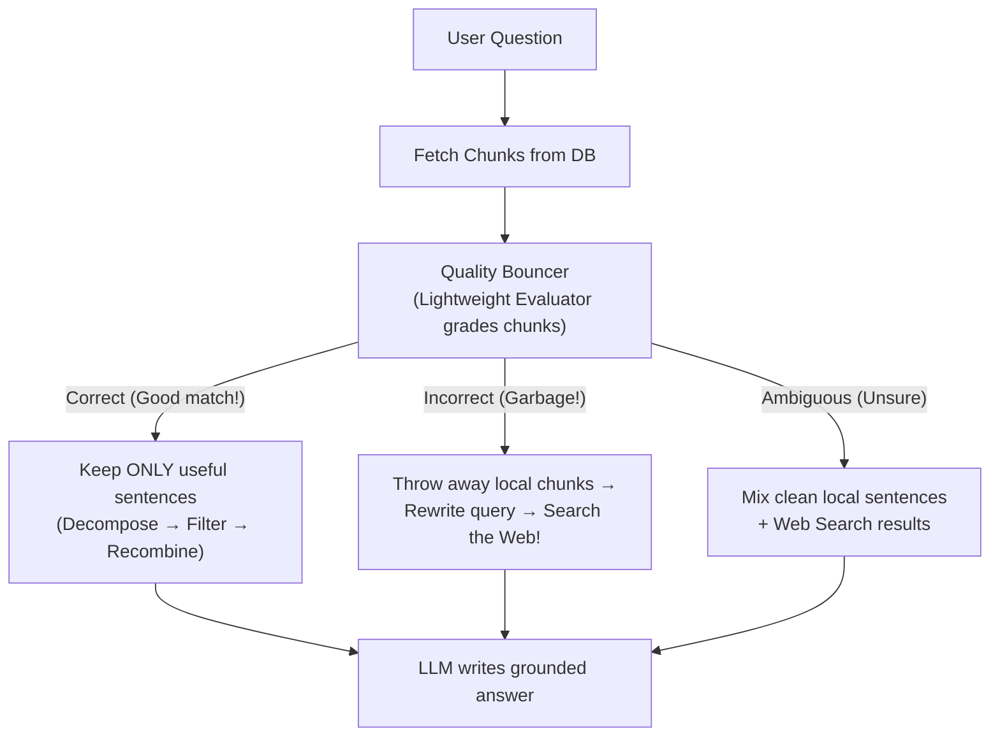

# Module 5: Fixing Every Way Basic RAG Fails (Advanced Retrieval Architectures)

> **Continuing Our Story (From Module 4 → Module 5):**  
> By the end of Module 4, we hooked our Vector Database and Knowledge Graph up to an LLM (**Basic RAG**). Users type a question, we grab the top 5 matching chunks, and the LLM writes an answer.  
> **Then real users start using it—and immediately find 7 frustrating ways Basic RAG breaks!**  
> *Note: No class PPTs were uploaded for Module 5, so every single fix below is explained in plain English from the original papers and engineering guides!*

---

## Syllabus Checklist (Every Topic Covered)
- **5.1** Advanced Chunking & Retrieval Optimization: Fixed-Length vs. Recursive vs. Semantic Chunking, IR Optimization
- **5.2** Advanced RAG Architectures: Contextual Retrieval (Anthropic), Corrective RAG (CRAG), Self-RAG, Microsoft GraphRAG architecture & workflows, Multimodal RAG

---

## Chapter 1 (Syllabus 5.1): Fixing Bad Scissors & Bad Queries

### Failure 1: *"My system chopped the answer right in half!"* → Better Chunking
Why can't we embed an entire 50-page PDF into one vector? Because 50 pages blended into one dot loses every specific detail! So we slice documents into **chunks**. Look how slicing evolved from dumb scissors to smart scissors:

1. **Fixed-Length Chunking (Dumb Scissors):** Cuts strictly every 500 characters or tokens (maybe with 50 tokens overlap).
   - *Good:* Super fast and cheap.
   - *Bad:* Cuts right through the middle of sentences, tables, and answers!
2. **Recursive Chunking (Smart Structural Scissors — Industry Default):** Tries splitting politely in priority order: `First try paragraph breaks (\n\n) → if still too big, try line breaks (\n) → then sentence ends (. ) → then spaces`.
   - *Good:* Keeps paragraphs and sentences whole!
   - *Bad:* Still doesn't know if two back-to-back paragraphs are about totally different subjects.
3. **Semantic Chunking (Topic-Aware Scissors):** Splits text into individual sentences, embeds every sentence, and checks how similar each sentence is to the next one. **Whenever meaning suddenly jumps** (cosine similarity drops sharply—say, paragraph 3 switches from *Python syntax* to *Cooking recipes*), it makes a cut right there!
   - *Good:* Each chunk stays focused on one clean topic.
   - *Bad:* Slow and costly during setup because you have to embed every single sentence.
4. *(Bonus Trick — Parent-Child Chunking):* Search using **tiny 200-token chunks** (easy to match accurately), then hand the LLM the **larger 1,000-token parent paragraph** around it so the LLM gets full context!

---

### Failure 2: *"Users ask vague questions, and the LLM misses answers buried in noisy results!"* → IR Optimization

Suppose a user types a vague 4-word query, and vector search grabs 20 messy chunks. LLMs suffer from **"Lost in the Middle"**—they read the start and end of a long prompt well, but overlook facts buried in the middle! Here is how we optimize **before**, **during**, and **after** searching:

1. **Before Searching (Fix the User's Question):**
   - **Query Rewriting:** Clean up vague follow-ups (`"What are its side effects?"` → `"What are the side effects of Salbutamol?"`).
   - **Multi-Query Expansion:** Ask an LLM to reword the question 3–5 ways, search for all of them, and merge hits so you don't miss anything.
   - **HyDE (Hypothetical Document Embeddings):** Short questions don't look like long textbook answers on a meaning map! So ask an LLM to **write a fake pretend answer first**, embed *that fake answer*, and search the database! Even if a detail in the fake answer is wrong, its **style and vocabulary** match real answer chunks way better than the short question!
   - **Step-Back Prompting:** Zoom out first (`"What happened in 1923 with X?"` → also search `"Overview and history of X"`).
2. **During Searching:** Use **Hybrid Search (BM25 + Dense + RRF)** and **Metadata Filtering** (from Module 2!).
3. **After Searching (Trim the Noise):**
   - **Two-Stage Reranking:** Grab top-50 candidates fast, then let a smart **Cross-Encoder** carefully score all 50 and pass only the **best 5** to the LLM.
   - **Contextual Compression:** Delete useless filler sentences inside each retrieved chunk before giving it to the LLM.

---

## Chapter 2 (Syllabus 5.2): Five Modern RAG Upgrades (Each Fixes One Big Flaw!)

### Upgrade 1 — Failure 3: *"The chunk forgot WHICH company or year it came from!"* → Anthropic's Contextual Retrieval
Imagine cutting a 100-page financial report into 500-token chunks. One chunk says:  
> `"The company's revenue grew by 3% over the previous quarter."`

Sitting alone in a vector database, **that chunk is homeless!** Neither BM25 nor embeddings know it's about **ACME Corp in Q2 2023**!

**Anthropic's Fix (Before Saving Each Chunk):**
Show the full document + that chunk to an LLM (cheaply using prompt caching) and have it stamp a quick 50-token sticky note onto the top of the chunk:
> *"[Context: From ACME Corp's Q2 2023 SEC filing; Q1 revenue was \$314M.] The company's revenue grew by 3% over the previous quarter."*

Then save this **contextualized chunk** into **both** the Embedding index (**Contextual Embeddings**) AND the keyword index (**Contextual BM25**), plus optionally run a **Reranker**.  
*Result:* Cuts retrieval failures by **49%** (and **67%** with a reranker)!

---

### Upgrade 2 — Failure 4: *"Our database didn't have the answer, so it fed garbage to the LLM!"* → Corrective RAG (CRAG)
Basic RAG blindly hands whatever top-5 chunks it found to the LLM—even if all 5 are totally off-topic!

**CRAG puts a strict "Quality Bouncer" (Retrieval Evaluator) right after retrieval:**

- **Why "Knowledge Refinement" matters even when `Correct`:** Instead of dumping a whole noisy paragraph, CRAG splits it into tiny sentence strips, drops distracting sentences, and hands the LLM only clean facts!
- **Why Web Search fallback matters:** If the local files are outdated or missing the answer, CRAG refuses to guess from bad chunks and fetches fresh facts online.

---

### Upgrade 3 — Failure 5: *"Our RAG searches even for 'Write a poem', and never checks its own answer!"* → Self-RAG
Notice CRAG needs an external bouncer and *always* searches the database first. What if **one smart LLM could judge itself** while writing?

**Self-RAG (Self-Reflective RAG)** trains an LLM to pause and emit **4 secret self-check tags ("Reflection Tokens")** inside its own thought stream:
1. **`[Retrieve]` (`Yes` / `No`):** *"Do I even need to search?"* Skips search for `"Write a poem about rain"`; triggers search for `"Who won the 2022 Physics Nobel?"`.
2. **`[ISREL]` (`Relevant` / `Irrelevant`):** Checks each retrieved chunk—throws out irrelevant chunks right away!
3. **`[ISSUP]` (`Fully Supported` / `Partially` / `No Support`):** Checks its own draft sentence against the chunk—catches itself if it starts hallucinating!
4. **`[ISUSE]` (`1 to 5`):** Grades how genuinely helpful the final answer is to the user.

Using these 4 self-check scores, Self-RAG compares candidate answers in parallel and picks the best-supported, most helpful reply!

---

### Upgrade 4 — Failure 6: *"Vector search fails completely on big-picture questions!"* → Microsoft GraphRAG
Suppose you upload 1,000 engineering incident reports and ask:  
> *"What are the top 5 recurring themes causing outages across the entire company?"*

Vector search only pulls the top-5 matching chunks—**it can never zoom out to see patterns across all 1,000 documents!**

**Microsoft GraphRAG ("From Local to Global") solves both big-picture AND zoomed-in questions in 2 phases:**

1. **Setup Phase (Offline):**
   - Split documents into chunks → use an LLM to extract **Entities, Relationships, and Claims** into a **Knowledge Graph**.
   - Run the **Leiden clustering algorithm** to group tightly connected entities into **hierarchical communities** (small sub-groups inside bigger themes, like cities inside states inside countries!).
   - Have an LLM write a **Summary Report** for every community from the bottom up!
2. **Answering Phase (Two Workflows):**
   - **Global Search (For Big-Picture Questions):** Uses **Map-Reduce** over all those pre-written **Community Summaries**! In parallel, an LLM reads batches of summaries to draft partial answers + importance scores (**Map**), then merges the highest-scoring insights into one dataset-wide answer (**Reduce**).
   - **Local Search (For Specific Entity Questions):** Like *"How does Drug X interact with Disease Y?"* Finds those seed entities, fans out across connected graph neighbors, claims, community summaries, and raw text chunks, and hands the rich local picture to the LLM.
   - *(Bonus: **DRIFT Search** starts with Global summaries to steer follow-up Local searches!)*

---

### Upgrade 5 — Failure 7: *"My system ignores charts, scanned tables, diagrams, and audio!"* → Multimodal RAG
Real PDFs and company drives aren't plain text—they're packed with bar charts, scanned forms, images, and recordings. Three clean ways to handle them in RAG:

1. **Describe Everything as Text:** Run OCR + VLM captioning (or Whisper for audio) so every chart/image becomes a text paragraph, then run normal text RAG. *(Easy, but loses subtle visual shapes/colors.)*
2. **Search by Text Summary → Show Raw Image to a VLM (Multi-Vector Parent-Child):** Store a crisp text summary of each chart/table in your vector DB so search finds it easily, **but keep the original image linked**—at answer time, pass the **actual raw image** to a Vision-Language Model (GPT-4o / Gemini / Claude) so it reads the real pixels!
3. **Native Visual Search (CLIP / ColPali):** Embed **raw images or whole PDF page screenshots directly** alongside text in a multimodal vector space (**ColPali** matches PDF pages visually by patch embeddings—zero fragile OCR needed!), then feed the retrieved page images straight to a VLM!

---

## Where We Go Next → Module 6
Look how far we've come: we have fast Hybrid + ANN search (Module 2), a clean Knowledge Graph built from multimodal documents (Modules 3–4), and smart self-correcting RAG & GraphRAG (Module 5)!  
**Now for the final chapter (Module 6):**  
1. What if a question needs **multiple tools and steps** (KG + Vector + Web Search + APIs)? Let's build **Autonomous AI Agents & Multi-Agent Teams**!  
2. Before we launch to real users, **how do we mathematically prove our system works** (Classical IR metrics, **NDCG**, **MRR**, **RAGAS**)?  
3. And when a user asks *"WHY did the AI give me this answer?"*, **how do we make every result transparent and explainable?** Let's finish strong in **Module 6**!
