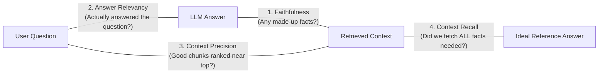

# Module 6: Autonomous AI Agents, System Evaluation & Explainable Search

> **Continuing Our Story (The Grand Finale — Module 6):**  
> We have built fast vector databases, multimodal Knowledge Graphs, and advanced GraphRAG. Before going live, our system must pass **three final milestones**:  
> 1. **Give the AI "Hands" & Teamwork (6.1):** Break huge questions into steps, pick tools dynamically (KG queries, web search, APIs), and coordinate specialized AI agents!  
> 2. **Prove It Works With Numbers (6.2):** Grade both the search retriever and the LLM generator using classical benchmarks (TREC, NDCG, MRR) and modern **RAGAS / LLM-as-Judge**! *(Note: `Information Retrieval Evaluation (1).pdf` covers 6.2 classical evaluation—including a subtle typo on Slide 35 that we will fix!)*  
> 3. **Explain *Why* (6.3):** Never show users a mysterious black-box score—trace clear graph paths, map overlays, visual boxes, and multi-database sources!

---

## Syllabus Checklist (Every Topic Covered)
- **6.1** GraphRAG with multimodal context, Query decomposition & KG reasoning paths, Agentic AI systems (tool usage: search engines, KG querying, APIs; multi-agent workflows) *(no PPTs — explained simply from online sources)*
- **6.2** Evaluation of retrieval systems: Standard test collections, Metrics (**NDCG, Recall@K, MRR**, + Precision, Recall, $F_1$, MAP), **RAGAS framework**, Assessing relevance & answer quality, **LLM as a Judge** *(combines `Information Retrieval Evaluation (1).pdf` + Slide 35 typo fix + online RAGAS guide)*
- **6.3** Explainability for IR systems: Graph-based reasoning paths & interpretability, Enterprise KGs, Geospatial analytics, Multimedia IR, Distributed IR *(no PPTs — explained simply from online sources)*

---

## Chapter 1 (Syllabus 6.1): Multimodal GraphRAG & Agentic AI Teams *(Not in PPTs — Online Sources)*

### 1. GraphRAG With Multimodal Context
In real projects, answers span **text + images + tables + audio**.
- Store text chunks, images (`:Image`), tables (`:Table`), and audio (`:Audio`) connected inside your Multimodal KG (`-[:HAS_FIGURE]->`, `-[:RECORDED_NEAR]->`), indexed with **both** text vectors (SBERT) and visual vectors (CLIP/ColPali).
- At query time, search finds starting nodes → walks the graph to gather connected facts **and attached figures/audio** → hands both the **graph paths** and **raw images/text** to a Vision-Language Model (VLM) for a complete grounded answer!

### 2. Breaking Hard Questions Down & Walking Reasoning Paths
Suppose a user asks: *"Which drugs treat diseases that share both Cough and Breathlessness, what side effects do they have, and how does Salbutamol work?"*
One single search query can't solve that!
- **Query Decomposition:** A planner splits the giant prompt into small sub-questions:
  1. *(KG / Cypher or SPARQL):* Find diseases with `Cough` AND `Breathlessness` → `Asthma, COPD`.
  2. *(KG / Cypher or SPARQL):* Find drugs & side effects for those diseases → `Salbutamol → Tremor`.
  3. *(Vector Search):* Find medical paragraphs explaining how Salbutamol works.
  - Sub-questions can run **in parallel** (comparing two independent companies) or **one after another** (Step 2 needs the answer from Step 1!).
- **KG Reasoning Paths:** Instead of dumping 500 random nodes into the prompt, trace crisp step-by-step chains from the starting entity to the answer:  
  $$\text{Asthma} \xrightarrow{\text{treatedBy}} \text{Salbutamol} \xrightarrow{\text{hasSideEffect}} \text{Tremor}$$
  Methods like *Think-on-Graph (ToG)* even let the LLM choose which arrow to walk next at each hop!

### 3. Agentic AI: Tool Usage & Multi-Agent Workflows
Old RAG is like a train on fixed tracks: `Query → Search → Answer`. **Agentic AI** is like a smart researcher with **a toolbox** running in a **ReAct Loop (`Think → Pick a Tool & Act → Observe Result → Repeat until Done`)**!

**Tools an Agent Uses:**
- **KG Query Tool:** Runs `Text-to-Cypher` / `Text-to-SPARQL` or safe graph path templates.
- **Search Engines & Vector DB:** Hybrid local search or live Web Search fallback.
- **APIs & Calculators:** Weather/ERP/CRM REST APIs, SQL queries, Python code for math.
- **Two Handy Industry Standards (from Syllabus Self-Learning):**
  - **MCP (Model Context Protocol):** A universal plug ("USB-C for AI") so any AI agent can safely plug into databases, KGs, or APIs.
  - **A2A / ACP (Agent-to-Agent Communication):** Lets separate specialized agents talk to each other and hand off tasks.

**Multi-Agent Workflows (Teamwork Over One Giant Prompt):**
Instead of stuffing 15 tools into one confused AI, build a small specialist team (using **LangGraph**, **CrewAI**, or **AutoGen**):
1. **Planner / Orchestrator Agent:** Breaks the query down and assigns jobs.
2. **Specialist Retrieval Agents:** A *KG Agent* writes Cypher/SPARQL; a *Vector/Vision Agent* checks documents & charts; a *Web/API Agent* fetches live external facts.
3. **Critic / Verifier Agent:** Checks if anything is missing or hallucinated, enforces **guardrails** (no destructive `DELETE` queries, no leaking private data), and sends gaps back for another try.
4. **Synthesizer Agent:** Writes the final clear answer with graph citations!

---

## Chapter 2 (Syllabus 6.2): Proving Your System Works (Evaluation & RAGAS)

You can't launch an AI search engine just because "two test questions looked good"! Let's learn how engineers scientifically test search and RAG.

### 1. Classic Testing Rules & Human Agreement (Prof's PPT)
- **What are we really measuring?** Whether we satisfied the user's **Information Need**—not whether words literally matched! Three types of needs: **Navigational** (*"open YouTube"*), **Informational** (*"how does BM25 work?"*), **Transactional** (*"book train ticket"*).
- **3 Ingredients of Any Search Test (Cranfield Experiments — 1,398 articles, 225 queries):**
  1. A **Document Collection**
  2. A **List of Test Queries**
  3. **Human Relevance Labels** (`Relevant` vs `Not Relevant`, or grades `0–4`)
- **Standard Public Benchmarks:** **TREC** (NIST, since 1992), **MS MARCO** (~1M Bing queries, huge for neural search), **Natural Questions** (real Google questions + Wikipedia).
- **Pooling (Saving Human Labor):** Humans can't label 10 million pages per query! So we take only the **top-$k$** results from several different search engines, put them in a **pool**, and ask humans to judge *just* that small pool.
- **Do Two Human Judges Agree? (Cohen's Kappa $\kappa$):**
  $$\kappa = \frac{P(A) - P(E)}{1 - P(E)}$$
  where $P(A)$ = how often they actually agreed, $P(E)$ = how often they'd agree by pure coin-flip luck ($\kappa=1$ perfect, $0$ chance, $<0$ worse than chance).
  - *Slide 41 Example:* Two judges label 400 docs (`Yes/Yes=300`, `No/No=70`, disagree `20` and `10`):  
    $P(A) = \frac{370}{400} = 0.925$, $P(E) = \left(\frac{80+90}{800}\right)^2 + \left(\frac{320+310}{800}\right)^2 = 0.2125^2 + 0.7875^2 = 0.665$ *(Slide 41 prints `0.7878`, a tiny typo for `0.7875`)* → **$\kappa = \frac{0.925-0.665}{1-0.665} = 0.776$**.

- **Checking If Improvement Is Real or Just Luck (Statistical Significance Tests):**
  If System B beats System A on average (`0.40` vs `0.20`), maybe it just got lucky on 2 weird queries! Run **Sign Test**, **Wilcoxon Signed-Rank Test**, or **Paired $t$-test** (use two-tailed if unsure) to get a **$p$-value**.

> [!CAUTION]
> **Critical Typo in Prof's Slide 35 (`Information Retrieval Evaluation (1).pdf`):**  
> Bullet 2 rightly says rejecting the null hypothesis ($H_0$) means the observation is **not** random, **but Bullet 3 wrongly writes** *"we seek to show that the observation **is** a random result"*.  
> **Remember the truth:** A tiny $p$-value ($p < 0.05$) lets us reject $H_0$ and prove our improvement is **NOT** random luck!

---

### 2. Scoring Search Results: From Simple Sets to Graded Lists

#### A. Simple Set Metrics (Ignoring Order)
- **Precision ($P$):** Out of everything the system showed me, what fraction was actually good? $\frac{TP}{TP + FP}$.
- **Recall ($R$):** Out of all the good docs in the whole database, what fraction did it find? $\frac{TP}{TP + FN}$.
- **$F_1$ Score (Harmonic Mean):** $F_1 = \frac{2PR}{P+R}$.  
  *Why Harmonic Mean instead of normal average?* If a lazy system returns **every single document in the database**, it gets `Recall = 0.99` and `Precision = 0.01`. A normal average gives `0.500` (looks okay!), while Harmonic Mean gives **`0.019`** (catches the terrible precision immediately!).

#### B. Ranking Metrics (Order Matters!)
1. **Precision@K ($P@K$) & Recall@K ($R@K$):** Look **only at the top $K$ results**!
   - *Example:* Top 5 results have 3 relevant docs → **$P@5 = 3/5 = 0.60$**.
   - **Recall@K** = $\frac{\text{relevant docs in top } K}{\text{total relevant docs in corpus}}$ (critical for RAG: did the answer chunk make it into the top-$K$ passed to the LLM?).
2. **11-Point Interpolated Average Precision:** Smooths sawtooth Precision–Recall curves ($p_{\text{interp}}(r) = \max_{r'\ge r} p(r')$) and averages across 11 recall levels (`0.0, 0.1, ..., 1.0`).
3. **MAP (Mean Average Precision):** Best when users want **many** relevant docs. For each query, compute $P@K$ at **every spot where a relevant doc shows up** (unretrieved relevant docs get `0`), average them (`AvgPrec`), then average across all queries!
   - *Example:* Relevant docs at ranks 1, 3, 5 → $\text{AP} = \frac{1/1 + 2/3 + 3/5}{3} = 0.756$.
4. **MRR (Mean Reciprocal Rank):** Best when you only need **one** right answer fast (e.g., *"What is the Wi-Fi password?"*):
   $$\text{MRR} = \frac{1}{|Q|} \sum_{q} \frac{1}{\text{rank of FIRST relevant doc}}$$
   - *Example:* Query 1 finds answer at #2 (`1/2 = 0.5`), Query 2 finds it at #1 (`1/1 = 1.0`) → $\text{MRR} = \frac{0.5 + 1.0}{2} = \mathbf{0.75}$.

#### C. Graded Relevance: DCG & NDCG (When Some Results Are "Okay" and Others Are "Amazing!")
Binary metrics treat `"Barely Relevant"` the same as `"Perfect Match"`. **NDCG** handles star ratings (`0` = Bad to `4` = Excellent) and gives **bigger rewards when the best docs sit right at the top**!
- **DCG (Discounted Cumulative Gain):** Add up each result's rating (or exponential gain $2^{\text{rel}_i} - 1$), **divided by a log penalty** $\log_2(1 + i)$ so lower ranks count less:
  $$\text{DCG}_p = \sum_{i=1}^{p} \frac{2^{\text{rel}_i} - 1}{\log_2(1 + i)} \qquad \left(\text{or simpler form: } \text{rel}_1 + \sum_{i=2}^{p} \frac{\text{rel}_i}{\log_2 i}\right)$$
- **NDCG (Normalized DCG):** Divide your system's DCG by the **Ideal DCG ($\text{IDCG}_p$)** (the highest possible score if results were sorted perfectly `[4, 3, 2, 1, 0]`):
  $$\text{NDCG}_p = \frac{\text{DCG}_p}{\text{IDCG}_p} \in [0, 1]$$
  - *Class Slide 33 Example:* Ideal `[4,3,2,1,0]` gives $\text{IDCG} = 21.35$. Ranking Function 1 (`[2,3,1,4,0]`) gets $14.38 / 21.35 = \mathbf{0.67}$; Ranking Function 2 (`[4,2,3,0,1]`) gets $20.78 / 21.35 = \mathbf{0.97}$.

---

### 3. Grading Complete RAG Pipelines: The RAGAS Framework & LLM-as-Judge *(Not in PPTs — Online Sources)*
Normal metrics only check *which docs were found*, not *whether the LLM lied*! **RAGAS** uses **LLM-as-a-Judge** to score **4 parts** of a RAG pipeline separately:

1. **Faithfulness (Did the LLM hallucinate?):** Breaks the LLM's answer into single claims and checks what fraction are actually backed by the retrieved chunks (`Supported Claims / Total Claims`).
2. **Answer Relevancy (Did the LLM dodge the question?):** Asks an LLM to guess what question the answer looks like it's answering, then checks embedding similarity against the *real* user question! (Catches answers that are true but off-topic.)
3. **Context Precision (Did useful chunks appear first?):** Checks whether the truly helpful chunks are ranked at the top of the retrieved list instead of buried under noise.
4. **Context Recall (Did the retriever miss critical facts?):** Compares retrieved chunks against a reference answer to see what fraction of needed facts made it into the context.

*(How to debug with RAGAS: Low Context Recall/Precision → fix chunking/search/reranking. High Context scores + Low Faithfulness → fix LLM prompt/hallucinations! Remember LLM-as-Judge biases: Position, Verbosity, and Self-preference.)*

---

## Chapter 3 (Syllabus 6.3): Why Should Anyone Trust the Answer? (Explainable IR) *(Not in PPTs — Online Sources)*

If a neural search engine just says *"Result #1 scored 0.87"*, a doctor, lawyer, or auditor will ask: **"WHY?"** **Explainable IR (XIR)** turns mysterious black-box rankings into clear, auditable reasons across 5 real-world settings:

1. **Graph-Based Reasoning Paths & Interpretability (White-Box AI):**
   Instead of a mysterious vector similarity score, Knowledge Graphs show the exact chain of facts:  
   `Patient → SUFFERS_FROM → Asthma → TREATED_BY → Salbutamol → HAS_SIDE_EFFECT → Tremor`  
   Along with exact document & page numbers—so a human can verify every single hop in 5 seconds!
2. **Enterprise Knowledge Graphs (Trust at Company Scale):**
   Connects messy company silos (HR, Finance, Docs, Code) under one clear ontology with **provenance** (who extracted each fact, when, from which file) and **access rules (ACL/RBAC)** so secret records never leak to the wrong user.
3. **Geospatial Analytics & IR (Location + Search):**
   Answers location-aware questions like *"Find trauma hospitals within 5 km of flooded areas."* Uses fast spatial indexes (**R-trees**, **Geohash / H3**, **Neo4j Point Index**), and explains results visually with **distance circles, map heatmaps, and boundary zones** (e.g., *"Ranked #1 because it is 400m away and open 24/7"*).
4. **Multimedia Information Retrieval (Images, Audio, Video):**
   Retrieves photos, songs, or video clips via multimodal models (CLIP, Whisper) and explains *why* by drawing **highlight boxes around matching objects in an image** or pointing to **exact video timestamps** (`0:45–1:12 matches 'engine repair'`).
5. **Distributed IR (Searching Across Many Separate Databases):**
   When data lives across multiple independent servers or hospital databases (**Federated Search**), a central **Broker** does 3 steps: (1) learns what each database holds (**Resource Representation**), (2) routes the query only to relevant databases (**Resource Selection**), and (3) combines their rankings fairly (**Result Merging**). Explainability here means **routing & source transparency**—telling the user *which* databases were queried, *why* others were skipped, and *how* scores were combined!

---

## Quick Viva Questions & Plain-English Answers

1. **Q: How does Query Decomposition work with Knowledge Graphs?**  
   *A:* It breaks a complex multi-part question into simple sub-questions (run in parallel or step-by-step), sending relationship lookups to Cypher/SPARQL and explanation lookups to Vector RAG before combining them.
2. **Q: What is the ReAct loop in Agentic AI, and what are MCP and A2A?**  
   *A:* **ReAct** alternates **Reason** → **Act (call a tool like Cypher, Search, or API)** → **Observe** until solved. **MCP** is a standard plug connecting agents to tools/data; **A2A** lets specialized agents collaborate in multi-agent teams (like LangGraph or CrewAI).
3. **Q: Why use $F_1$ (Harmonic Mean) instead of a regular average?**  
   *A:* A dumb system returning every document gets `Precision=0.01, Recall=0.99`. A normal average gives `0.50` (misleading!), whereas Harmonic Mean gives `0.019`, immediately exposing the junk results.
4. **Q: MRR vs. MAP vs. NDCG in one line?**  
   *A:* **MRR** checks only how high the *first* good result sits; **MAP** checks *all* relevant binary results; **NDCG** handles *graded star ratings* (`0–4`) and rewards putting the absolute best grades at the very top.
5. **Q: What did Slide 35 of the IR Evaluation PPT get wrong?**  
   *A:* It wrote that rejecting the null hypothesis shows the result *is* random; in truth, a small $p$-value ($p < 0.05$) rejects $H_0$ and proves the improvement is **NOT** random luck.
6. **Q: What are the 4 RAGAS metrics?**  
   *A:* **Faithfulness** (answer sticks to context, no hallucination), **Answer Relevancy** (answer addresses the question), **Context Precision** (best chunks ranked on top), and **Context Recall** (all facts needed for the ideal answer were retrieved).
7. **Q: Why are Knowledge Graphs much more explainable than vector search?**  
   *A:* Instead of an opaque cosine number (`0.84`), KGs show the exact chain of entities and relationships (`A → rel1 → B → rel2 → C`) plus exact source document citations.
8. **Q: What are the 3 steps of Distributed IR (Federated Search)?**  
   *A:* Resource Representation (knowing what's in each DB), Resource Selection (picking which DBs to query), and Result Merging (combining rankings fairly into one list).
